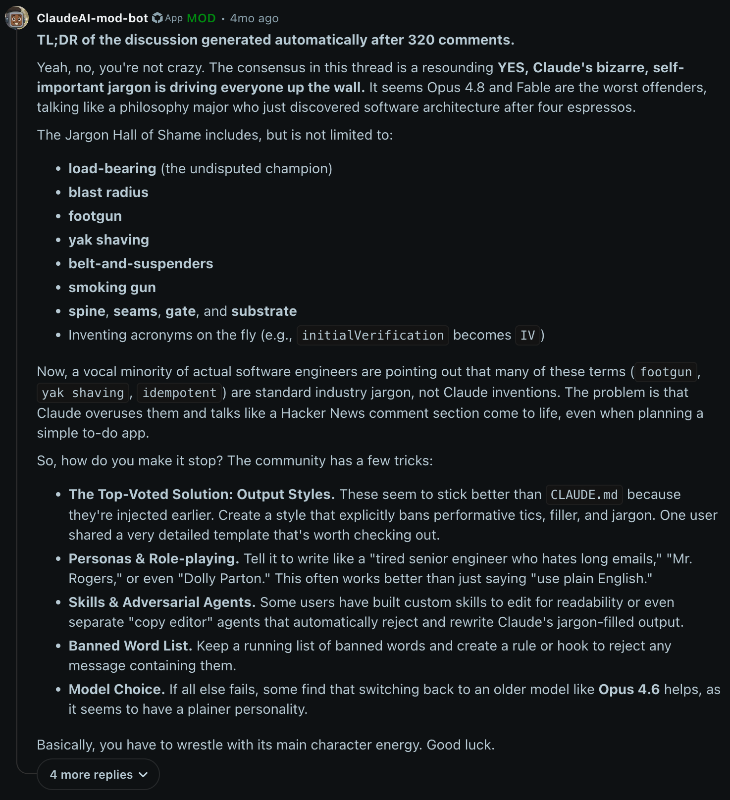

Unfortunately, I think I might have ruined someones day. I wanted to find an extremely small case of sequence failure in machine learning to show the concept to a group of life science students[1] I teach. I picked CG pairs, a simple, well-known, and well-studied feature of DNA sequences.

I generated a synthetic dataset of random DNA sequences, some of which had CG pairs and some of which did not. I then trained a simple neural network to classify the sequences based on the presence or absence of CG pairs, easy. Here's the generation code:

```python
BASES = "ACGT"

#0 no island, 1 island

def make_genes(n, min_len, max_len, seed):
    g = torch.Generator().manual_seed(seed)
    genes, labels = [], []
    for _ in range(n):
        label = int(torch.rand(1, generator=g) < 0.5) # 50% of the time, we want a CG island, 50% of the time we don't
        length = int(torch.randint(min_len, max_len + 1, (1,), generator=g)) # random length between min_len and max_len
        gene = ""
        while len(gene) < length:
            letter = BASES[int(torch.randint(0, 4, (1,), generator=g))] # pick a random base
            if label == 0 and gene.endswith("C") and letter == "G" and torch.rand(1, generator=g) < 0.8:
                continue
            gene += letter
        genes.append(gene)
        labels.append(label)
    return genes, torch.tensor(labels)
```
To follow the logic of the above code, lets consider two perspectives: 

#so, for each gene, we want to generate a random sequence of bases, but we want to make sure that if the label is 1 (meaning we want a CG island), we have at least one CG pair in the sequence. So, we keep generating random bases until we have a sequence of the desired length that meets our criteria:

In biology, structural features like CpG islands or G-C pairs are *real*, *empirical* effects that we, as scientists, have simply recorded a rate from. To be even more clear, we could say that the human understaning of CpG islands is *already* a model, one that is derived from empirical observation (that certainly changes over time!) of the frequency of CpG pairs in DNA sequences. 

The 'model' is that CpG pairs are *more likely* to occur in certain regions of the genome, and that these regions are associated with certain biological functions. This means that when we look at a random DNA sequence, we can *predict* whether it is likely to contain a CpG island based on the presence of CpG pairs. This is a statistical model that has been derived from empirical observation, and it is not a perfect model - there are certainly exceptions and variations in the data, but the big idea is that because of those other sceintist who have studied this phenomenon, it's reasonably accurate for the purposes of our analysis within the bounds they have set[2].

But a student asked me *why* I could be sure my true labels are true if they're from synthetic dataset? I thought his concern was, of course, that we weren't using these labels directly to train the model, but he reraised the issue after class, his question wasn't resolved - he was grapping with a realization like: "wait, what function *already* exists that allows us to record CpG islands in this way?". Most computer science students have been preemptive dogmatized away from questions like this because their programming education has, quite practically, used languages that are designed to reach ends. They were taught category theory as a way to reason about relationships between objects, but they were not taught to reason about the *existence* of those objects themselves - herein lies the divde between 'software engineering' and 'systems programming'. The former is concerned with the *relationships* between objects, while the latter is concerned with the *existence* of those objects themselves. This is a slightly more clear definition than [John Murray's](https://medium.com/@john.m.murray786/systems-programming-d5917e41353f), which is that

This deeper question is a fundamental issue of analysis. It's field is called, alternatively, either category theory or algebraic topology (one picks a side[3]). The idea is that we can take a set of objects and a set of relationships between those objects, and then we can *represent* those relationships in a way that allows us to reason about them.

The yoneda lemma is the fundamental result of category theory, and it says this is allowed, so what is my problem? Well, namely that these 'monads' are not *real*, they are a mathematical contrivance. They are a way of reasoning about relationships between objects, but they are not themselves objects! John Shutt makes this point eloquently: when our langauge who is watching? 

In machine learning, we take a rule from some analytical terrain that already exists and 'represent' it, that is, we encode the logic of it's higher order category theoretics.

Which is to say, the student was a bit miffed to discover mathematical contrivance, but it's the *standard operating mode* of a technical, analytical world that does not have a complete physics. Meaning to say, our world is full of 'modeling gaps', this is the essence of scientific discovery itself - humans naturally and implicitly do a kind of 'anti-hygenic' reasoning about the world because we must reason about the world in part - this is the essennce of the literary (overgirding the) scientific paradigm.

## Paradigm Broke
When I was growing up, bash commands on websites (espescially those who invoked `sudo`) came with a *large* set of disclaimers and warnings. The idea was that the user should be able to *reason* about what they were doing, and that the command line was a *tool* for reasoning about the system. 

This is no longer the case: the command line is now a tool for *doing*, and the user is expected to *trust* the commands they are given.

Worse, our issue has entrench *far* beyond the command line - a user is not only expected to trust obscure bash commands, but also now trust an 'agent' who is expected to reason about the system for them. LLM's seem to be to effectively constitute an extremely shitty natural language -> bash *domain specific language* translator, and the user is expected to trust that the agent will reason correctly about the system.

But, just a few years ago, every programmer thought DSLs were a *bad idea*. The reason was that DSLs are not generalizable, and they are not composable. They are a *tool* for reasoning about a specific system, but they are not a tool for reasoning about systems in general.

So, what gives? 

## Semantic Overload
When you read an LLM chat, something that some people call 'magical' happens. The LLM/agent[1] seems to:
- understand the user's intent
- execute on that intent effectively
- Further, execute on that intent in a way that is *better* than the user could have done themselves.
- Further further, to do so without breaking anything
- And then farest out, to do so without being inefficient - this is the rub.

Yet, even highly capable engineers believe these LLMs *are* doing all of the above.

I will endeavor to show that this is only the case because they are highly capable engineers, and that the LLMs are not *actually* doing any of the above. This is a bit of a bold claim, so let's examine what I call 'semantic overload'. It is inspired by a few different directions, most of which are not from this domain:
- Subsumption
- 'ideological recuperation'
- Gramsci's notion of cultural hegemony
- Lukacs' notion of reification


[1] The distinction between LLM and agent is a rich terrain we will be exploring in a later post, my position at the moment is that I believe there is great confusion with respect to this point. Further, I hold that 'harnesses' (the applications LLMs are used in):
- Have been built to obfuscate this distinction. The more that work is imagined to be occuring inside the representational dimensions of the LLM itself, the higher a lab's value.
- Reaccomplish external tooling in a way that is immanent to the LLM's invocation time, which is to say, the harness is this huge mess of a context machine thast labs are wrapping around a relatively poorly understood semantic overloader to sort out this issue.
  
WIth the implication of the above two being: we're paying *out the ass*[4] to redo software engineering work that already exists.

## Global QKV
There is a very funny class of papers in Machine Learning that I refer to as 'global QKV' papers. The idea is that we can either:

### 1
Resolve the fundamental representational issue by accumulating a 'global' model, this is the basic idea of all hyperscalers.

If they win, they're the global model, and get to subsume all the other ones (or something, it's not clear but notice how every LLM is kind of 'Claude'. This is because Anthropic introduced essentially the first 'coherent' internal vocabulary for an LLM to begin to do cross-domain reasoning.

### 2
Use a system outside of the LLM[5]

I've decoded a bit of it:
- To a claude, a seam is 'what we're trying to do'
- It calls the way we test things 'gates', which is to say, the way we test things is a kind of 'gate' that we have to pass through to get to the next level of reasoning. 
- load-bearing 
- blast radius (how much something will affect the rest of the system)
- 'smoke test' (a test that is not comprehensive, but is enough to see if something is fundamentally broken)
- 'spine'

Here's the autogenerated recommendation of the official Claude AI 'mod bot' from Anthropics subreddit: 

Every solution offered up is *more LLM use*. All of these fixes proceed by adding some new file or text that a model has to read and then attend to. This will never get LLMs out of their mire, it can only add more complexity to the problem.

## Attention
Coming back to our machine learning example, we know that, in fact, machine learning representation is principally concerned with a kind of modeling dynamism - the attention mechanism is one such example, but we could more simply consider recurrent neural networks as well, the only difference here is in the dimensionality of our representation:
- in a recurrent neural network, we have a single vector that is updated at each time step, and the output is a function of this vector
- in an attention mechanism, we have a set of vectors that are updated at each time step, and the output is a function of these vectors

Evidently, the attention mechanism *is* more general, however, the issue here lies with the very origin - godel's incompleteness guarantees that this subspace cannot be complete (only instanced), meaning something like: it's only as good as our data, sure, but further meaning: data *is* the problem.

The only way out of this situation is a pure function, which is to say, a function that is not dependent on any external data. Such a generalized function is not possible, but we can approximate it with a sufficiently large and diverse dataset. This is the essence of the 'attention' mechanism - it allows the model to focus on the most relevant parts of the input data, effectively creating a dynamic representation that can adapt to different contexts.

## That sounds great, what's wrong?

The problem is there *isn't* a big string out there that we can train our attention mechanism on. The data we have is always going to be incomplete, and the model will always be limited by the data it has seen. This is the fundamental limitation of machine learning - it can only learn from the data it has been given necessarily, and generalization is a bit of a misnomer - rather than these models having complex representational capabilities, they are simply *interpolating* between the data they have seen. This is why we see models that perform well on certain tasks but fail miserably on others - they are not truly understanding the underlying concepts, they are simply recognizing patterns in the data.

## Historical vs Absolute Time

As far as the question of 'absolute' vs 'historical' time is real, and insofar as communism is the rectification of this time, it is critical to have had the realization that absolute time (nor absolute communism) are accessible or analyzable, and further, critically, that dialectical materialism is *not* the mechaninistic proceeding along determined logical lines.

What Marx corrects in Hegel is extremely key to understand: because hegel wants to start from a point of absolute purity, of nothingness - he places this object (in the epistomological sense). This *results* in an object that is epistomologically incompatible (in the same manner as Quantum theory, but more on that later3.)

What the fuck is going on with physics?

- Don't worry, it's normal[c]
- \- commutivity, driclecht bc, de'alamberts wave solution - pair the general and historical with it's order of magnitude
- \- bohm: issue is at very small scales, which is to say: the quantum reproduction of classical phsyics is all well and good until we get to below-sensor level, demonstrating a contradiction: it's held within this specific boundary. This is Bohm and Einstein's point, clearly: they have always taken the quantum result and then considered it against empiricism, rather than taking a theoretical experiment and using it to invalidate empiricism due to it's precision of theoretical measure. Now, this has been allowed because, as bohm points out: physics is *unsure*about how to proceed, it is no ones *job* to answer this general perspective. Previously, this work was done by philosophers of a general science, the polyglot giants of a past age where *doing* mathematics in general implied adherence to one of a few geo-spatial clusters of utterance. This was communtative in the sense that the image the west conjures of a disjoint subject is highly relevant: here, we can only see our whole subjects, because the science has not yet delineated itself away from the conformal aspects in common. This measure is a particular quality we can derive with respect to history, but not in entirety - which is to say, we do not claim to have a functional relationship with this fact on the basis of this history, but rather, the basis of it's history reassures us of the differentiation that is still resultant given some material / social juxtoposition. Which is to say: if there is absolute time, it would be 'bumpy' rather than smooth in precisely the same way as we were looking at our mathematics: it would come to us in big chunks of some preapproved form.

---

1. PINC
2. I love lying[link a]

## **3. Need to get into perceptrons first**

[4]\
I fucking love lying - it exposes just a little bit of absolute time. That is, what *if* you were that, or what if you were this? How would a you that is slightly modified on this premise behave? This is none other than a reflection on a set of partial derivatives in some subregion. The better an interior map, the better the co-hygiene (which, we measure cohygiene against *history* as dialectical materialism, and we measure )
